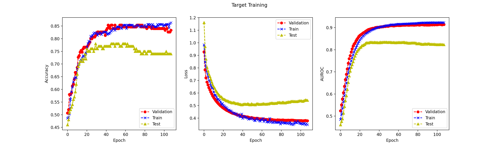

# Dog Breed Classification

A PyTorch image classification project comparing convolutional neural networks,
supervised transfer learning, and a Vision Transformer on a small dog breed dataset.
The target task distinguishes **Golden Retrievers** from **Collies**; an eight-breed
source task supplies pretrained convolutional features.

## Results

Freezing all three pretrained convolutional layers improved held-out test AUROC
from **0.7304 to 0.8228**, an absolute increase of **0.0924**.

| Model / Strategy | Validation AUROC | Test AUROC |
| --- | ---: | ---: |
| CNN trained from scratch | 0.9623 | 0.7304 |
| Pretrained CNN, all layers fine-tuned | 0.9550 | 0.7588 |
| Pretrained CNN, first convolution frozen | 0.9559 | 0.7680 |
| Pretrained CNN, first two convolutions frozen | 0.9484 | 0.7652 |
| Pretrained CNN, all three convolutions frozen | 0.9147 | **0.8228** |
| Vision Transformer trained from scratch | 0.9550 | 0.5532 |

These are historical results from the original experiments, selected by minimum
validation loss within each run. The CNN/ViT baseline values come from the local
experiment report; transfer results were checked against saved checkpoint statistics.
They are retained in [the benchmark record](docs/benchmark.json). The current code
includes evaluation and checkpoint fixes, so new runs may produce different values.

The validation/test gap motivates examining generalization on limited data. Frozen
source features performed best on this test split, while the small ViT had weaker
test performance. These observations do not establish a general ranking of CNNs
and ViTs or prove the cause of the distribution gap.



## Approach

- **Preprocessing:** RGB images at 64 x 64 pixels; per-channel normalization fitted
  only on the training split and reused for validation, test, and prediction.
- **CNN:** three convolutional layers, max pooling, and a binary classification head.
- **Transfer learning:** eight-class source training, convolutional weight transfer,
  a new binary head, and comparisons with zero through three frozen convolutions.
- **ViT:** patch embeddings, a learned classification token, sinusoidal positional
  embeddings, and two transformer encoder blocks with multi-head attention.
- **Training:** cross-entropy, Adam, deterministic random seeds, validation-loss
  early stopping, and automatic selection of the best validation-loss checkpoint.
- **Experiment sweep:** four freezing configurations followed by six combinations
  of dropout and weight decay, with training-only horizontal flips. Configurations
  are ranked by validation AUROC at their best validation-loss checkpoint.

Training reports accuracy, loss, and AUROC on train/validation data. Test evaluation
runs after checkpoint selection; test metrics do not drive the experiment sweep.

## Setup

Use Python 3.11 or newer and run commands from the repository root.

```bash
python3 -m venv .venv
source .venv/bin/activate
python -m pip install -r requirements.txt
```

### Local Data

Dataset files and pretrained weights are not distributed with this repository.
The scripts expect local files in the following layout:

```text
data/
  dogs.csv
  images/
    <image filenames referenced by dogs.csv>
```

`dogs.csv` must contain these columns:

| Column | Meaning |
| --- | --- |
| `filename` | Image filename relative to `data/images/` |
| `semantic_label` | Breed name |
| `numeric_label` | Zero-based class ID; may be empty for unlabeled images |
| `partition` | `train`, `val`, `test`, or `challenge` |
| `task` | `source` or `target` |

The original target split contains 300 training, 150 validation, and 100 test images,
plus 200 unlabeled images. The source split contains 2,000 training, 1,200 validation,
and 1,200 test images across Samoyed, Miniature Poodle, Saint Bernard, Great Dane,
Dalmatian, Chihuahua, Siberian Husky, and Yorkshire Terrier.

Paths, batch sizes, and learning rates are configured in `config.json`.
Images must be RGB and 64 x 64 for the supplied model architectures. Custom datasets
can follow the same metadata schema, with two target classes and eight source classes.

### Training And Evaluation

```bash
# Baseline CNN
python train_cnn.py
python test_cnn.py

# Eight-class source pretraining, then four freezing strategies
python train_source.py
python train_target.py

# Vision Transformer baseline
python train_vit.py
python test_vit.py

# Transfer learning and regularization sweep (requires the source checkpoint)
python train_challenge.py

# Predict positive-class probabilities for unlabeled target images
python predict_challenge.py --output results/predictions.csv
```

Training continues from the latest local model checkpoint when one exists; Adam's
optimizer state is initialized anew. Evaluation and source transfer automatically
load the checkpoint with the lowest validation loss. Use a new checkpoint directory
in `config.json` for an independent training run. The sweep starts each configuration
from source weights and writes its summary to `results/experiments.json`.

Training plots are saved as PNG files. For a terminal-only environment, set
`MPLBACKEND=Agg` before running a training command. The supplied training scripts
run on CPU; GPU training is not wired into the training loop.

### Checks

```bash
python -m pip install -r requirements-dev.txt
python -m pytest
ruff check .
```

Unit tests use synthetic data and do not require the dataset or saved weights.

## Repository Layout

```text
model/                  CNN and ViT architectures
dataset.py              Dataset loading and train-only normalization
train_common.py         Metrics, early stopping, and checkpoint utilities
train_cnn.py             CNN baseline
train_source.py          Eight-class source pretraining
train_target.py          Transfer learning comparisons
train_vit.py             ViT baseline
train_challenge.py       Freezing and regularization sweep
predict_challenge.py     Unlabeled image inference
tests/                  Synthetic regression tests
docs/                   Historical results and resume wording
config.json             Local experiment configuration
```

PDF reports, all CSV files, datasets, model checkpoints, prediction exports,
environments, and caches are excluded by `.gitignore`. Representative plots remain
in the repository for inspection.

## Background

This portfolio version grew out of an EECS 445 image classification project.
The repository preserves the experiments while adding documentation, regression
tests, and fixes to checkpoint transfer, evaluation, and experiment selection.
The ViT implementation retains credit to Brian Pulfer's educational implementation
in `model/vit.py`.
